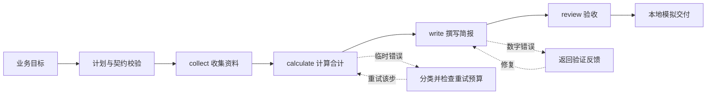

# guiji 职场：协作机制研发学习与讲解手册

版本：2026-10-20。预设读者：有基础编程经验、尚未系统学习多智能体协作的研发同学。使用方式：先读第 1—5 节建立认识，再做第 6 节实验，最后按第 9 节向别人讲解。

本文是学习规划、机制说明和实验指南。方案建议、已实现实验和论文原始机制分别标明；示例销售数据均为模拟数据。

## 1. 你这项工作到底要交付什么

一句话定义：**协作机制研发，是让多个 Agent 能按规则分工、交接、推进任务，并在发生错误时恢复执行的一套运行机制。**

可以把它理解为一个项目经理与任务系统的组合：记录、进度可追踪。项目经理决定怎么分工，任务系统确保工作没有丢失、没有重复交付、失败有

LLM 可以提出计划，但“计划是否合法、任务是否完成、下一步是否可以启动”需要运行时检查。判断不应只依赖 Agent 的一句“完成了”。

### 1.1 输入、输出与边界

| 项目 | 需要定义的内容 |
|---|---|
| 输入 | 用户目标、可用 Agent、工具、资料范围、预算、时限、验收规则 |
| 输出 | 可验收产物、任务结果、完整执行轨迹、失败或等待原因 |
| 本模块负责 | 任务结构、分配决策、状态流转、消息交接、恢复策略和运行观测 |
| 与模型/Agent 开发的接口 | Agent 声明能力、接收任务、调用工具、返回结构化结果与错误 |
| 与知识模块的接口 | 通过授权引用获取资料与经验；保存资料版本，便于追溯 |
| 与业务方的接口 | 确认什么叫成功、何时必须询问人、哪些操作不可自动重复 |

“让 Agent 更聪明”与“让协作系统更可靠”需要分别评估。某个 Agent 算错数
据，是能力问题；算错后仍被系统认定成功，是验收机制问题；崩溃导致结果丢失，是运行时问题。

### 1.2 先澄清的六个业务问题

在正式开发前，形成一页书面约定：典型任务是什么？角色和工具有哪些？产物怎样验收？哪些任务有外部副作用？最长运行多久、最多花多少钱？哪些情况需要人工补充信息？

这些答案决定状态机、路由和重试策略，不能仅通过选择框架来解决。

## 2. 如何拆解这项研发工作

五个原始职责之外，要先补边界定义，最后补评估。建议拆成七个工作包，并按下表顺序建立最小闭环。

| 工作包 | 要回答的问题 | 交付物 | 先学什么 | 通过标准 |
|---|---|---|---|---|
| W0 场景与边界 | 服务什么任务，成功是什么？ | 典型案例、输入输出、验收与权限约定 | 需求分析、接口契约 | 同一案例的成功/失败判定没有歧义 |
| W1 任务拆分 | 要做哪些子任务，有何依赖？ | Task Schema、任务 DAG、计划校验器 | DAG、拓扑排序、前置与后置条件 | 拒绝循环、缺失依赖和不明确的交接 |
| W2 路由 | 谁能做，谁现在能接？ | Agent 能力目录、候选过滤与排序规则 | 能力匹配、硬约束与软评分 | 不把任务分给无权限/无能力者；无候选时有明确结果 |
| W3 状态管理 | 做到哪，失败后从哪继续？ | Task/Attempt、状态迁移表、持久化与恢复接口 | 状态机、事务、检查点 | 中断后保留已提交进度，历史尝试可追踪 |
| W4 消息交接 | 怎么发、怎么确认、重复如何处理？ | 消息 Schema、消息处理器、去重机制 | 请求响应、消息确认、幂等、Outbox/Inbox | 重复消息不重复产生约定的业务效果 |
| W5 重试与恢复 | 再试、换人、改计划还是停止？ | 错误分类、恢复决策表、尝试与预算上限 | 超时、退避、反馈修复、补偿 | 不无限重试，未知副作用不盲目重做 |
| W6 观测与评估 | 能说明为什么成功或失败吗？ | 事件轨迹、故障实验、对照报告 | 日志关联、失败归因、实验设计 | 可还原执行过程，指标定义明确且可复查 |

### 2.1 第一版研发范围建议

采用固定角色、小规模任务图、规则路由、单进程执行、持久化任务状态、有限重试和确定性验收。完成闭环后，再扩展并行 Worker、动态拆分、学习路由与跨服务消息。

原因：如果同时引入随机模型输出、并发执行、动态计划和复杂消息，失败时很难分辨是哪一层出错。分阶段增加复杂度，才能逐项理解与验证。

### 2.2 各包之间的依赖

W0 约定成功条件 → W1 定义工作单元 → W2 决定执行者 → W3 跟踪执行 → W4 交接结果 → W5 处理异常 → W6 检验整套机制。

实际开发时 W3 和 W6 应尽早出现，避免先做出“能跑”的协作流程，后续却没有足够的状态与事件用于排错。

## 3. 用一个完整案例理解五种机制

用户要求：“基于提供的模拟季度数据，写一份销售简报，并检查数字是否一致。”

资料为三个月销售额 100、120、140，正确合计为 360。整个流程不访问生产业务，也不真实发送报告。



### 3.1 拆分：把“写报告”变成有契约的工作单元

| 子任务 | 输入 | 执行者能力 | 输出 | 验收 |
|---|---|---|---|---|
| collect | 指定模拟资料 | research | 来源标识、三个月数字 | 来源与数据符合案例约定 |
| calculate | collect 的数据 | analysis | total | 等于输入数字求和 |
| write | calculate 的 total | writing | total、text | 报告数字与计算一致 |
| review | write 的产物 | review | 验收结果 | 运行时独立规则再检查 |

为什么这样拆？每一步的输入输出与失败原因不同，可以独立验收和重做。任务过粗，会让一次失败重跑大量工作；过细，会增加调用、交接与调度成本。合理粒度通常是“有明确输入、产物、验收规则，且值得独立重试的一段工作”。

本案例是链式依赖。若另加“准备报告模板”，它可以与 collect 同时进行，write 则同时依赖模板和 calculate。**没有依赖是并行的必要条件，还要检查写同一文件、工具限流等资源冲突。**

### 3.2 路由：为什么不是随机选一个 Agent

先过滤：Agent 是否具备 analysis 能力？是否能访问当前资料？是否有调用所需工具的权限？再排序：当前是否忙碌？历史质量如何？成本和延迟如何？

需要区分：

- 任务拆分：决定“有哪些工作”。
- Agent 路由：决定“交给哪个角色或能力单元”。
- 模型路由：决定“该 Agent 使用哪个模型”。
- 实例调度：决定“由哪个具体 Worker、在何时执行”。

一个模型配置多个提示词角色仍可构成逻辑多 Agent，但不代表它们真的同时运行，也不天然具有知识隔离或操作系统安全隔离。

### 3.3 状态：为什么只记一段聊天不够

聊天记录可能写着“马上完成”，却无法可靠回答任务是否提交成功、当前尝试是谁、结果是否被验收。需要明确状态与版本。

建议生产模型区分：Run 是一次用户请求；Task 是一个逻辑子任务；Attempt 是该任务的一次执行；Artifact 是产物；Event 是发生过的事情。

例如 calculate 是同一个 Task：第一次超时为 Attempt 1，第二次成功为 Attempt 2。上游 collect 不需要因为这次超时重做。

| 状态 | 含义 | 典型下一步 |
|---|---|---|
| pending | 尚未具备启动条件 | 依赖满足后 ready |
| ready | 可被调度 | 分配后 running |
| running | 某一次尝试正在执行 | 成功、等待、重试或失败 |
| retry_wait | 等待下一次尝试 | 到达重试时间后 ready |
| waiting_input | 缺资料或需要人工决定 | 输入到达后重新校验 |
| succeeded | 产物通过约定验收 | 解锁下游 |
| failed | 本次任务无法继续 | 保留根因，等待显式修复流程 |
| canceled | 用户或上层取消 | 不再接受迟到结果推进任务 |

这是一套推荐状态模型。附带教学代码为了易读，省略 ready、waiting_input 和取消流程，不能把上表都当成已实现。

### 3.4 消息：收到了为什么还不算完成

“消息已投递”只说明到达接收端；“接受任务”说明接收者愿意处理；“结果返回”说明处理结束；“验收通过”才说明可以推进业务。

```json
{
  "message_id": "msg-001",
  "run_id": "run-001",
  "task_id": "calculate",
  "attempt_id": "attempt-2",
  "sender": "analyst",
  "recipient": "coordinator",
  "type": "result",
  "plan_version": 1,
  "artifact_ref": "artifact-total-360-v1"
}
```

这是建议的消息格式示意。消息 ID 用于辨认同一条消息；业务操作键用于辨认同一个逻辑操作。发送者重建一条新消息时，message_id 可能变化，但同一交付操作的 operation_key 应保持不变。

把收件去重记录与本地业务更新放在同一事务中，可以避免“记录已收到后崩溃，业务却没执行”。向外部系统发送时还需要对方的幂等支持或状态核查，不能用本地去重推导出任意外部操作只执行一次。

### 3.5 恢复：为什么不把所有错误都重试三次

| 现象 | 根因类别 | 应对 | 不恰当做法 |
|---|---|---|---|
| 计算服务临时超时 | 暂态故障 | 有上限地重试 | 重跑整个报告 |
| 写成总计 999 | 内容错误 | 返回校验反馈，修复结果 | 等两秒原样重复请求 |
| Agent 无访问权限 | 权限/配置问题 | 显式失败或等待修正 | 无限重试同一个请求 |
| 资料没给齐 | 输入不足 | 询问、补充资料或调整目标 | 编造缺失数字 |
| 已完成计算后进程退出 | 执行中断 | 读取持久化结果继续 | 忘记旧进度重新开始 |
| 操作超时但可能已交付 | 结果未知 | 查询状态或使用有效幂等键 | 直接重复产生外部副作用 |

三个易混概念：retry 是同一工作再次尝试；repair 是带着错误反馈改正结果；replan 是改变剩余工作和依赖。补偿则是对已产生的业务效果执行另一个纠正操作，它通常不是数据库回滚，也未必能完全还原现实。

## 4. 必须学懂的知识地图

不建议先泛读大量论文。按“概念 → 手画例子 → 跑实验 → 看论文如何使用它”的顺序学习。

| 知识 | 通俗理解 | 需要掌握到什么程度 | 自测问题 |
|---|---|---|---|
| DAG 与拓扑排序 | 工作的先后依赖 | 会画图、检查循环、找可执行节点 | 为什么写报告不能在数据计算前开始？ |
| 任务契约与结构化输出 | 工作交接单 | 会定义输入输出、前提和验收规则 | JSON 合法是否代表数字正确？ |
| 状态机 | 每项工作当前处境 | 会列合法迁移和终态规则 | canceled 之后收到旧结果怎么办？ |
| 数据库事务 | 一组变更共同提交或撤销 | 理解状态、产物和事件的原子提交 | 先标完成再存产物，崩溃会怎样？ |
| 检查点与恢复 | 保存可继续执行的位置 | 能区分已提交结果与尚未提交尝试 | 已产生副作用却没存检查点怎么办？ |
| 幂等 | 重复执行不新增业务效果 | 区分消息键、操作键与结果缓存 | 新消息 ID 能否代表同一个交付操作？ |
| 租约与 fencing token | 有时限的任务所有权和代际凭证 | 理解 Worker 假死、改派与迟到覆盖 | 旧 Worker 恢复后为什么不能直接写结果？ |
| 错误分类与重试预算 | 不同故障采用不同处置 | 会按类型选择 retry/repair/replan/stop | SDK 和任务层都重试会放大多少调用？ |
| 日志与关联标识 | 一次协作的可追踪账本 | 能沿 run/task/attempt/message 还原过程 | 只记最终答案能否定位交接错误？ |
| 对照与消融实验 | 判断哪个改动真的有效 | 知道固定预算、数据和验收条件 | 提高成功率是否只是花了更多钱？ |

先掌握前六项，即可读懂教学代码。租约、分布式投递、并发与自动策略优化属于后续深化。

## 5. 论文应该怎么学，而不只是怎么收藏

### 5.1 第一轮只精读四篇

| 顺序 | 资料 | 关注位置 | 学习后交付 |
|---|---|---|---|
| 1 | [Magentic-One](https://arxiv.org/html/2411.04468v1)，2024 | §4.1 外循环、内循环与账本；§5 实验；§6 局限 | 画出计划、进度检查、执行者选择、停滞后重新规划的闭环 |
| 2 | [MetaGPT](https://arxiv.org/abs/2308.00352)，2023 | SOP、角色和中间产物交接 | 写一份销售案例的子任务契约 |
| 3 | [AutoGen](https://arxiv.org/abs/2308.08155)，2023 | 对话协作、角色与执行控制 | 给出你自己的任务、结果、错误消息格式 |
| 4 | [Why Do Multi-Agent LLM Systems Fail?](https://arxiv.org/abs/2503.13657)，2025 | MAST 分类、失败轨迹和验证终止问题 | 标注至少五条实验失败或故障轨迹 |

Magentic-One 维护任务与进度账本，用协调者组织专长 Agent 并在停滞时调整计划；这适合理解协调闭环。账本负责推理上下文，数据库检查点负责执行恢复，两者不能互相替代。[原文](https://arxiv.org/html/2411.04468v1)

第二轮再学 [TaskBench](https://arxiv.org/abs/2311.18760) 的拆分与工具评估、[RouteLLM](https://arxiv.org/abs/2406.18665) 的模型选择、[Reflexion](https://arxiv.org/abs/2303.11366) 的反馈修复。拓扑优化与通信裁剪放到第三轮，完整清单见项目根目录《协作机制研发_论文与落地路线.md》。

### 5.2 每篇论文填写同一张阅读卡

1. 问题：作者解决的是规划、路由、消息、恢复，还是评估？
2. 假设：角色固定吗？工具有哪些？是否有标准答案？
3. 机制：输入 → 状态 → 决策 → 动作 → 反馈的闭环是什么？
4. 证据：基准、模型、预算、对照方法和消融实验是什么？
5. 局限：是否覆盖进程崩溃、重复投递、未知副作用和人工等待？
6. 迁移：guiji 可以借鉴哪一点，必须补哪一层，如何验证？

能不用论文原话解释这六项，并画出机制图，才算形成自己的理解。

### 5.3 三份工程资料必须配套读

- [LangGraph Persistence](https://docs.langchain.com/oss/python/langgraph/persistence)：理解 checkpointer、执行状态和 thread_id；检查点不能自动消除外部副作用重复。
- [Transactional Outbox](https://microservices.io/patterns/data/transactional-outbox.html)：理解本地状态提交与发送消息之间的可靠交接；投递器仍可能重复发送。
- [AWS：Making retries safe with idempotent APIs](https://aws.amazon.com/builders-library/making-retries-safe-with-idempotent-APIs/)：理解请求重试与业务操作身份，特别是“成功但响应丢失”的情况。

## 6. 已提供的可运行机制实验

脚本：learning/coordination_lab.py。Python 标准库实现，无需模型密钥、网络、数据库服务或新增依赖。角色是确定性函数，用于隔离协作机制，不是真实 LLM Agent。

### 6.1 一键运行

在项目根目录 PowerShell 执行：

```powershell
.\.venv\Scripts\python.exe learning/coordination_lab.py test
.\.venv\Scripts\python.exe learning/coordination_lab.py demo
```

如不使用项目虚拟环境，也可使用本机 Python 3.10+，将上述解释器替换为 python。本次环境的实际验证版本见《实验验证记录.md》。

demo 每次创建一个新目录 learning/output/run-随机标识，保存五个场景的 SQLite 状态库与 report.json。重复运行不覆盖前一次实验。

### 6.2 五个场景与预期观察

下列尝试次数顺序统一为 collect、calculate、write、review。

| 场景 | 注入什么 | 预期尝试次数 | 观察重点 |
|---|---|---|---|
| normal | 无故障 | [1,1,1,1] | 按依赖执行，角色按能力选择 |
| retry | calculate 第一次超时 | [1,2,1,1] | 只重试失败任务，上游产物复用 |
| repair | write 第一次返回 999 | [1,1,2,1] | 错误结果被验收拦截，第二次才通过 |
| duplicate | 同消息重复投递，再换消息 ID 重发同一操作 | [1,1,1,1] | Inbox 去重与业务操作键共同约束，本地交付记录仍为 1 |
| crash_resume | calculate 提交后进程直接退出，父进程重新启动执行 | [1,1,1,1] | 从持久化结果继续，collect 与 calculate 没有重跑 |

关键事件：assigned 表示开始一次尝试；accepted 表示结果通过确定性验收；transient_retry 表示暂态错误；semantic_repair 表示验收反馈；duplicate_message_ignored 表示重复消息被忽略。

repair 场景的第二次输出由脚本预设，并不证明模型能理解反馈。crash_resume 在事务已提交后的指定位置退出，并不覆盖任意时刻的崩溃。delivery_count 是本地模拟交付计数，不是真实邮件、支付或外部发布。

### 6.3 手动演示进程退出和续跑

使用一个尚不存在的新数据库文件名，避免复用已完成实验：

```powershell
.\.venv\Scripts\python.exe learning/coordination_lab.py run --db learning/manual-demo-01.sqlite --crash-after calculate
```

第一次命令预期以退出码 17 结束，这是故障注入。随后执行：

```powershell
.\.venv\Scripts\python.exe learning/coordination_lab.py run --db learning/manual-demo-01.sqlite
```

检查四个任务 attempts 都为 1，并观察事件顺序：calculate 的 accepted 位于 write 的 assigned 之前。重新执行第二条命令，已完成任务不再运行，本地交付也不会增加。

若沿用已完成的数据库，第一条命令会跳过 calculate，不能再次演示该崩溃；应换一个新文件名。

### 6.4 如何阅读代码

按 validate_plan → route → worker/check_artifact → run → deliver → MechanismTests 的顺序。先读一个正常任务如何流转，再找错误分支，不必一开始逐行阅读全部程序。

| 函数 | 对应知识 | 你应该解释出的内容 |
|---|---|---|
| validate_plan | DAG | 为什么找不到任何可执行节点意味着存在循环 |
| route | 能力路由 | 为什么没有候选时必须报错 |
| worker | 执行者 | 为什么教学中先使用固定输出 |
| check_artifact | 独立验收 | 为什么格式正确仍可能是错误结果 |
| run | 状态、依赖、恢复与预算 | 为什么每次尝试前落库，结果通过验收后才提交成功 |
| deliver | 事务与幂等 | 为什么相同操作键但不同业务内容要拒绝 |
| MechanismTests | 故障验证 | 如何证明进程真的退出且上游没有重跑 |

### 6.5 已覆盖与尚未覆盖

已覆盖：固定计划的无环校验、能力匹配、串行依赖推进、SQLite 任务持久化、已提交结果恢复、有限尝试、确定性结果验收、本地 Inbox 与操作键去重、真实子进程退出场景。

尚未覆盖：LLM 动态拆分、真实模型反馈修复、多 Worker 并发、租约/fencing、跨进程消息代理、Outbox 投递、实际退避等待、费用预算、取消与人工等待、完整计划版本、跨服务副作用恢复。

尤其注意：脚本恢复时将遗留 running 状态重新开放，前提是前一个进程已经退出。多 Worker 系统不能照搬这一处理，需要租约和过期写入保护。

## 7. 从机制实验到论文复现

| 层次 | 可以证明什么 | 完成条件 |
|---|---|---|
| L1 机制复现 | 你理解并实现了某个工程机制 | 可运行、可注入故障、可检查状态与不变量；本次实验属于此层 |
| L2 简化架构复现 | 你实现了论文核心控制闭环 | 真实模型、任务账本、进度账本、执行者选择、停滞处理与停止条件 |
| L3 论文实验复现 | 在明确条件下重现论文评估 | 固定代码/模型/提示词/数据/预算，遵循评估协议，报告差异与不确定性 |

### 7.1 推荐下一步：Magentic-One 核心闭环的简化复现

先做 L2，而不是立即追求论文榜单成绩。选择它是因为协调者的计划、路由、进度管理和恢复与你的职责相符。

1. 固定资料与一组可独立验收的报告任务，禁止修改标准答案。
2. 接入一个真实模型执行计划与内容生成，明确记录模型 ID、日期、提示词和调用参数。
3. 实现任务账本：目标、已知事实、未知信息与当前计划。
4. 实现进度账本：是否完成、是否推进、是否循环、下一执行者与任务指令。
5. 设计停滞检测与有限重新规划，保留每一版计划和理由。
6. 比较固定流程与账本驱动流程，记录结果、调用次数、成本、延迟和失败根因。

这是借鉴论文机制的简化实现计划，不能命名为“已复现 Magentic-One 论文性能”。原论文使用通用工具 Agent 与 GAIA、AssistantBench、WebArena 等评估；若使用自建销售案例，只能报告本案例上的结果。[原文实验与架构](https://arxiv.org/html/2411.04468v1)

真实模型阶段涉及费用与随机性，进入该阶段前应明确模型、总预算、任务集和验收方式。本次没有发起付费调用。

### 7.2 复现报告模板

问题与假设；参考论文版本；原论文机制与本实现差异；环境和依赖；模型与参数；数据与验收标准；运行命令；对照条件；逐任务结果；故障轨迹；费用与延迟；失败分析；可复现范围与局限。

不要只写“运行成功”。必须说明哪条不变量得到验证，例如“重复三次交付请求，本地业务交付记录仍只有一条”。

## 8. 推荐学习安排：每一步都有产物

以下以学习单元组织，不承诺固定天数。一个单元可按基础分成多次完成。

| 单元 | 学习与实践 | 最终产物 |
|---|---|---|
| A 建立边界 | 读第 1—2 节，选一个自己的真实任务 | 一页模块职责与七个工作包 |
| B 解释机制 | 读第 3—4 节，手画任务图、状态机和消息顺序 | 三张图与一份任务契约 |
| C 亲手验证 | 跑五个场景，读事件轨迹，修改一次故障条件 | 一份实验记录，能解释每个场景 |
| D 对照论文 | 精读四篇，填写阅读卡，对照本地实现 | 四张阅读卡和机制差异表 |
| E 向他人讲解 | 按第 9 节演练并回答追问 | 20 分钟讲解与现场复现实验 |
| F 深化复现 | 接真实模型，做 L2 与固定流程对照 | 简化复现报告与代码版本 |

学习是否完成，用“能解释、能预测、能修改”判断：能解释每个模块为何存在；能预测一种故障会导致什么状态；能修改一个规则并用实验验证结果。

## 9. 直接用于向别人讲解的 20 分钟结构

| 时间 | 讲什么 | 展示材料 |
|---|---|---|
| 0—2 分钟 | 目标：多个 Agent 怎样完成一次可验收的工作 | 模块输入输出与职责边界 |
| 2—5 分钟 | 销售案例如何拆分，为什么这样分 | 任务 DAG 与子任务契约 |
| 5—8 分钟 | 谁来做、做到哪、如何交接 | 能力路由、Task/Attempt、消息示意 |
| 8—13 分钟 | 超时、内容错误、重复消息、崩溃怎么办 | 五个场景结果和一条失败轨迹 |
| 13—16 分钟 | 为什么采用这些机制 | 四篇论文与三份工程文档的对应关系 |
| 16—18 分钟 | 当前实现到什么程度，下一步是什么 | 已覆盖/未覆盖表，L1/L2/L3 区分 |
| 18—20 分钟 | 如何验收这项研发 | 成功率、恢复、成本、延迟与不变量 |

可以直接使用的开场：

> 我负责的是多 Agent 的协作运行机制。以生成销售简报为例，系统需要先把工作拆成收集、计算、写作和验收，再把任务交给有对应能力的 Agent。我的模块要保证工作按依赖推进，结果通过检查后才交给下游；超时、重复消息和进程中断发生时，系统仍能解释当前进度并选择正确的恢复动作。

### 9.1 常见追问与回答要点

**为什么要多 Agent？** 有明确能力差异、独立验证或可并行工作时可能有价值；是否优于单 Agent 必须比较，角色更多不自动意味着效果更好。

**和普通工作流有什么区别？** 执行保障可以沿用工作流知识；Agent 引入了动态计划、自然语言结果、工具选择与不确定推理，因此需要增加结构化契约、结果验证与有限重新规划。

**为什么不用聊天记录保存所有状态？** 聊天用于上下文，业务状态需要可查询、可校验、可并发控制和可恢复的明确表示。

**为什么消息要去重？** 发送者可能因响应丢失再次发送。传输成功与业务成功也可能不一致，必须以明确业务身份判断是否已经处理。

**检查点能保证所有操作只做一次吗？** 不能。外部副作用可能已发生但尚未记录，需要外部幂等或核查；检查点主要保存可恢复的执行进度。

**重试会让模型一定答对吗？** 不会。暂态错误可能通过重试恢复，内容错误需要反馈与验收，资料不足需要补充信息，所有路径都应有预算与停止条件。

**这个实验复现了哪篇论文？** 它复现了若干基础工程机制，没有复现任何论文的完整系统或性能。论文核心闭环的简化复现是下一阶段计划。

## 10. 对 guiji 现有工程的衔接建议

当前 research/engine.py 已有检索、压缩、分析、质疑、决策与引用检查的固定 LangGraph 流程。这可作为真实模型阶段的基线。当前调用未接 checkpointer，结果主要在结束时保存；优先补持久化进度与明确恢复身份，再扩展动态协作。

教学实验放在 learning/ 中，独立于现有业务模块。建议把学到的任务契约、Task/Attempt 区分和验收原则逐步迁移到现有流程，先通过故障实验，再增加动态计划和多 Worker。

最终对外说明应同时回答三件事：**我负责哪些机制；这些机制为什么这样设计；哪些结论已经被什么实验验证。**
